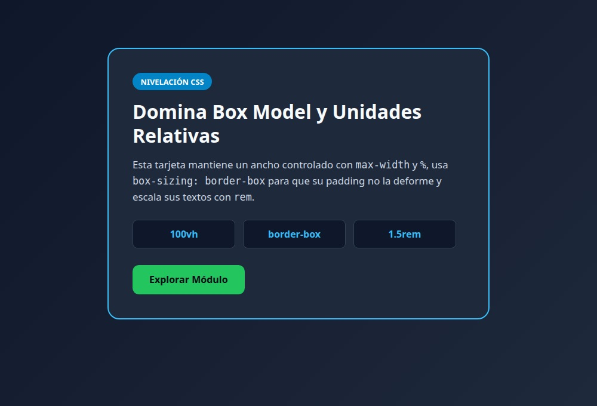
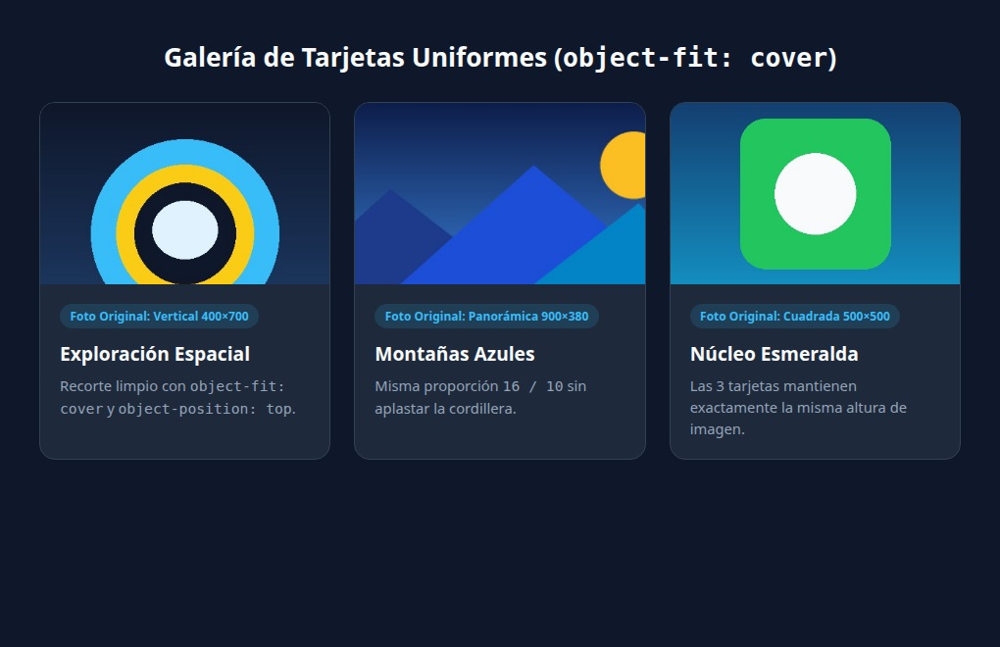
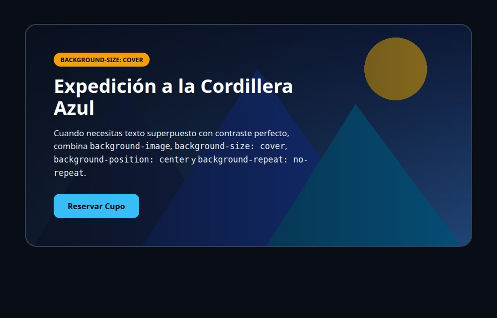
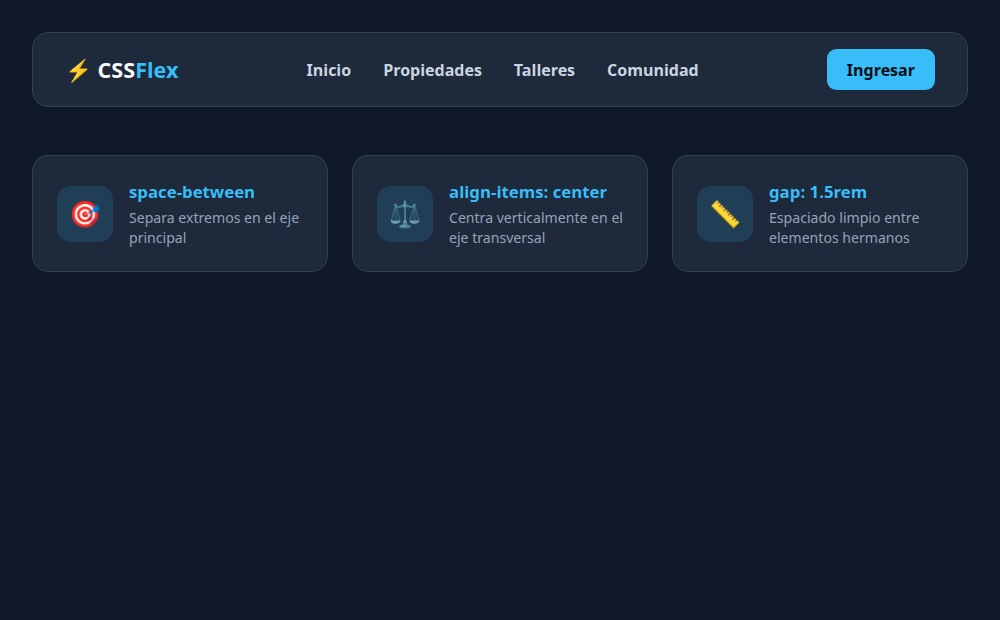
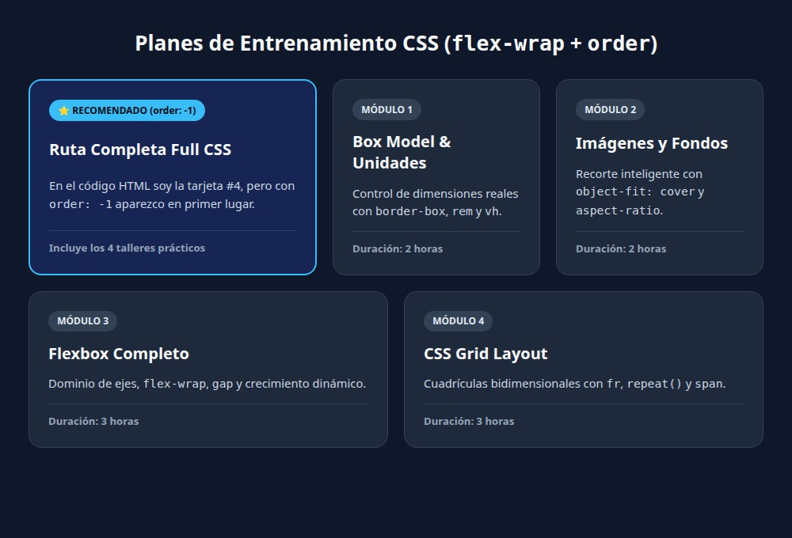
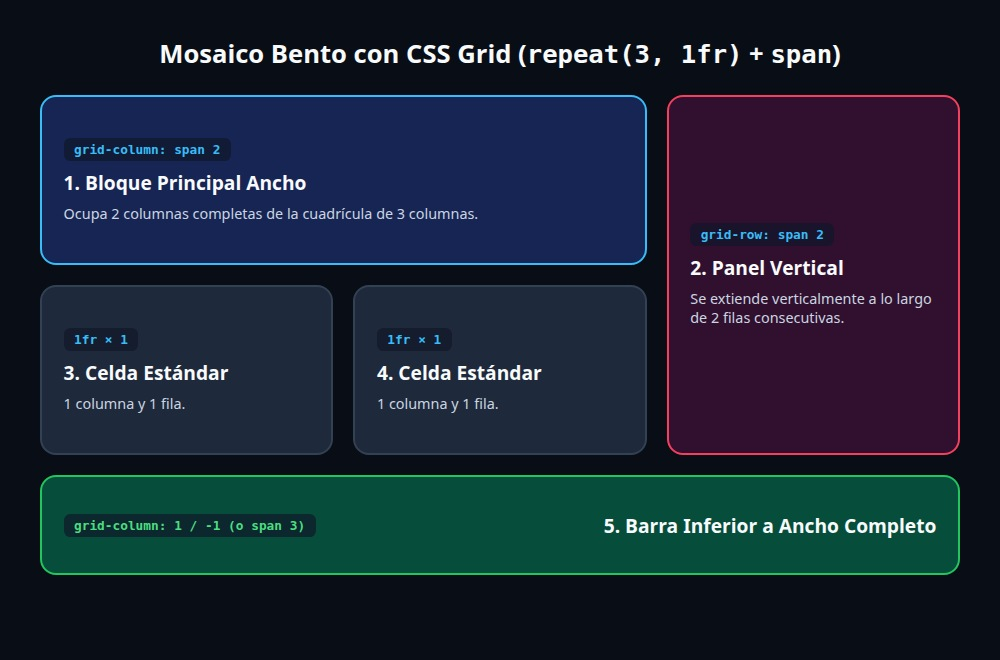
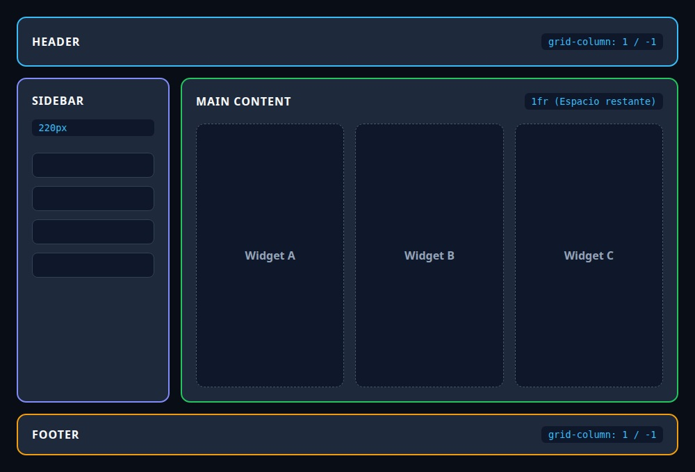

# Taller Práctico de Nivelación CSS

Bienvenido al taller práctico. El objetivo es aplicar las bases de **Box Model, Medidas Relativas (`vh`, `rem`, `%`), Imágenes (`object-fit`, `aspect-ratio`), Fondos (`background-size: cover`), Flexbox y CSS Grid** sin perder tiempo escribiendo HTML desde cero.

## ¿Cómo funciona la dinámica?

Cada reto se encuentra en su propia carpeta dentro de [`talleres/`](file:///home/antonio/Desktop/cssTaller/talleres) y contiene exactamente **3 archivos**:

1. **`index.html`**: Ya tiene toda la estructura y el contenido listos (**no necesitas modificar el HTML**).
2. **`resultado-esperado.jpg`**: La imagen de referencia con el objetivo visual al que debes llegar.
3. **`style.css`**: Archivo CSS vacío (con pistas en comentarios) donde tu única misión es escribir las reglas CSS.

---

## Módulo 1: Medidas Relativas (`vh`, `rem`, `%`) y `box-sizing: border-box`

### Reto 01 — Tarjeta Promocional y Pantalla Completa
- **Carpeta de trabajo:** [`talleres/01-medidas-y-box-model/`](file:///home/antonio/Desktop/cssTaller/talleres/01-medidas-y-box-model)
- **Archivos:** [`index.html`](file:///home/antonio/Desktop/cssTaller/talleres/01-medidas-y-box-model/index.html) | [`style.css`](file:///home/antonio/Desktop/cssTaller/talleres/01-medidas-y-box-model/style.css) | [`resultado-esperado.jpg`](file:///home/antonio/Desktop/cssTaller/talleres/01-medidas-y-box-model/resultado-esperado.jpg)



#### Características que debes lograr en `style.css`:
1. Activa `box-sizing: border-box` globalmente (`*`) y elimina los márgenes y rellenos por defecto (`margin: 0; padding: 0;`).
2. Haz que `.pantalla-completa` ocupe al menos el alto total de la ventana con `min-height: 100vh` y aplica un `padding: 3rem 1.5rem`.
3. Haz que `.tarjeta-promo` sea fluida con `width: 90%`, pero que no supere `max-width: 640px`, centrada con `margin: 2rem auto` y con `padding: 2.5rem`.
4. Convierte `.etiqueta`, `.caja-metrica` y `.boton` en `display: inline-block` para que respeten `padding`, `width` (`31%` en `.caja-metrica`) y márgenes verticales.

<details>
<summary>💡 Ver solución de referencia (CSS)</summary>

```css
* {
  box-sizing: border-box;
  margin: 0;
  padding: 0;
}

html {
  font-size: 16px;
  font-family: system-ui, -apple-system, sans-serif;
}

body {
  background-color: #0f172a;
  color: #f8fafc;
}

.pantalla-completa {
  min-height: 100vh;
  padding: 3rem 1.5rem;
  background: linear-gradient(135deg, #0f172a 0%, #1e293b 100%);
}

.tarjeta-promo {
  width: 90%;
  max-width: 640px;
  margin: 2rem auto;
  padding: 2.5rem;
  background-color: #1e293b;
  border: 2px solid #38bdf8;
  border-radius: 1.25rem;
}

.etiqueta {
  display: inline-block;
  padding: 0.35rem 0.85rem;
  margin-bottom: 1rem;
  background-color: #0284c7;
  color: #ffffff;
  font-size: 0.8rem;
  font-weight: 700;
  border-radius: 999px;
}

.titulo {
  font-size: 2rem;
  line-height: 1.25;
  margin-bottom: 1rem;
}

.descripcion {
  font-size: 1.05rem;
  line-height: 1.6;
  color: #cbd5e1;
  margin-bottom: 1.5rem;
}

.metricas {
  margin-bottom: 1.75rem;
}

.caja-metrica {
  display: inline-block;
  width: 31%;
  padding: 0.75rem;
  margin-right: 1.5%;
  background-color: #0f172a;
  border: 1px solid #334155;
  border-radius: 0.5rem;
  text-align: center;
  font-weight: 700;
  color: #38bdf8;
}

.boton {
  display: inline-block;
  padding: 0.85rem 1.75rem;
  background-color: #22c55e;
  color: #090d16;
  font-size: 1rem;
  font-weight: 800;
  text-decoration: none;
  border-radius: 0.65rem;
}
```
</details>

---

## Módulo 2: Imágenes (``) y Fondos (`background-*`)

### Reto 02-A — Cards de Imágenes con `object-fit: cover` y `aspect-ratio`
- **Carpeta de trabajo:** [`talleres/02-imagenes-y-fondos/reto-1-cards-img/`](file:///home/antonio/Desktop/cssTaller/talleres/02-imagenes-y-fondos/reto-1-cards-img)
- **Archivos:** [`index.html`](file:///home/antonio/Desktop/cssTaller/talleres/02-imagenes-y-fondos/reto-1-cards-img/index.html) | [`style.css`](file:///home/antonio/Desktop/cssTaller/talleres/02-imagenes-y-fondos/reto-1-cards-img/style.css) | [`resultado-esperado.jpg`](file:///home/antonio/Desktop/cssTaller/talleres/02-imagenes-y-fondos/reto-1-cards-img/resultado-esperado.jpg)



#### Características que debes lograr en `style.css`:
1. Las 3 imágenes en `img/` tienen dimensiones muy diferentes (`400×700` vertical, `900×380` panorámica y `500×500` cuadrada).
2. Haz que `.card-img` ocupe `width: 100%`, tenga proporción `aspect-ratio: 16 / 10` y use `object-fit: cover` para que ninguna imagen se deforme y todas tengan exactamente la misma altura.
3. En la primera imagen (`.foco-superior`), aplica `object-position: top` para enfocar el casco y el sol en la parte alta de la ilustración.
4. Agrega `overflow: hidden` y `border-radius: 1rem` a `.card` para recortar las esquinas superiores de la foto.

<details>
<summary>💡 Ver solución de referencia (CSS)</summary>

```css
* {
  box-sizing: border-box;
  margin: 0;
  padding: 0;
}

body {
  font-family: system-ui, -apple-system, sans-serif;
  background-color: #0f172a;
  color: #f8fafc;
  padding: 2.5rem;
}

.contenedor {
  max-width: 960px;
  margin: 0 auto;
}

.titulo-seccion {
  font-size: 1.65rem;
  margin-bottom: 1.75rem;
  text-align: center;
}

.fila-cards {
  display: flex;
  gap: 1.5rem;
}

.card {
  flex: 1;
  background-color: #1e293b;
  border: 1px solid #334155;
  border-radius: 1rem;
  overflow: hidden;
}

.card-img {
  width: 100%;
  aspect-ratio: 16 / 10;
  object-fit: cover;
  object-position: center;
  display: block;
}

.foco-superior {
  object-position: top;
}

.card-body {
  padding: 1.25rem;
}

.badge {
  display: inline-block;
  font-size: 0.75rem;
  font-weight: 700;
  background-color: rgba(56, 189, 248, 0.15);
  color: #38bdf8;
  padding: 0.25rem 0.65rem;
  border-radius: 999px;
  margin-bottom: 0.75rem;
}

.card-body h2 {
  font-size: 1.2rem;
  margin-bottom: 0.5rem;
}

.card-body p {
  font-size: 0.92rem;
  color: #94a3b8;
  line-height: 1.5;
}
```
</details>

---

### Reto 02-B — Tarjeta Hero con `background-image`, `cover` y `background-position`
- **Carpeta de trabajo:** [`talleres/02-imagenes-y-fondos/reto-2-hero-background/`](file:///home/antonio/Desktop/cssTaller/talleres/02-imagenes-y-fondos/reto-2-hero-background)
- **Archivos:** [`index.html`](file:///home/antonio/Desktop/cssTaller/talleres/02-imagenes-y-fondos/reto-2-hero-background/index.html) | [`style.css`](file:///home/antonio/Desktop/cssTaller/talleres/02-imagenes-y-fondos/reto-2-hero-background/style.css) | [`resultado-esperado.jpg`](file:///home/antonio/Desktop/cssTaller/talleres/02-imagenes-y-fondos/reto-2-hero-background/resultado-esperado.jpg)



#### Características que debes lograr en `style.css`:
1. Configura `.hero-card` con `min-height: 440px`, `padding: 3.5rem` y `border-radius: 1.5rem`.
2. Aplica `background-image` combinando un `linear-gradient` oscuro semitransparente y `url("paisaje-hero.jpg")`.
3. Asegúrate de que la imagen cubra toda la tarjeta sin repetirse y quede centrada usando `background-size: cover`, `background-position: center` y `background-repeat: no-repeat`.

<details>
<summary>💡 Ver solución de referencia (CSS)</summary>

```css
* {
  box-sizing: border-box;
  margin: 0;
  padding: 0;
}

body {
  font-family: system-ui, -apple-system, sans-serif;
  background-color: #090d16;
  color: #ffffff;
  padding: 3rem 2rem;
}

.wrapper {
  max-width: 900px;
  margin: 0 auto;
}

.hero-card {
  min-height: 440px;
  padding: 3.5rem;
  border-radius: 1.5rem;
  border: 2px solid #334155;
  background-image:
    linear-gradient(90deg, rgba(9, 13, 22, 0.88) 0%, rgba(9, 13, 22, 0.45) 100%),
    url("paisaje-hero.jpg");
  background-size: cover;
  background-position: center;
  background-repeat: no-repeat;
  display: flex;
  align-items: center;
}

.hero-contenido {
  max-width: 520px;
}

.tag-hero {
  display: inline-block;
  background-color: #f59e0b;
  color: #090d16;
  font-size: 0.78rem;
  font-weight: 800;
  padding: 0.35rem 0.85rem;
  border-radius: 999px;
  margin-bottom: 1rem;
}

.hero-contenido h1 {
  font-size: 2.4rem;
  line-height: 1.15;
  margin-bottom: 1rem;
}

.hero-contenido p {
  font-size: 1.05rem;
  line-height: 1.6;
  color: #e2e8f0;
  margin-bottom: 1.75rem;
}

.btn-reserva {
  display: inline-block;
  background-color: #38bdf8;
  color: #090d16;
  font-weight: 800;
  text-decoration: none;
  padding: 0.85rem 1.75rem;
  border-radius: 0.75rem;
}
```
</details>

---

## Módulo 3: Flexbox (Ejes, Alineación, `flex-wrap` y `order`)

### Reto 03-A — Barra de Navegación y Tarjetas de Estadísticas
- **Carpeta de trabajo:** [`talleres/03-flexbox/reto-1-navbar-y-alineacion/`](file:///home/antonio/Desktop/cssTaller/talleres/03-flexbox/reto-1-navbar-y-alineacion)
- **Archivos:** [`index.html`](file:///home/antonio/Desktop/cssTaller/talleres/03-flexbox/reto-1-navbar-y-alineacion/index.html) | [`style.css`](file:///home/antonio/Desktop/cssTaller/talleres/03-flexbox/reto-1-navbar-y-alineacion/style.css) | [`resultado-esperado.jpg`](file:///home/antonio/Desktop/cssTaller/talleres/03-flexbox/reto-1-navbar-y-alineacion/resultado-esperado.jpg)



#### Características que debes lograr en `style.css`:
1. En `.navbar`, usa `display: flex`, `justify-content: space-between` y `align-items: center` para distribuir el logo a la izquierda, los enlaces al centro y el botón a la derecha.
2. En `.nav-links`, usa `display: flex` y `gap: 2rem`.
3. En `.fila-stats`, coloca las 3 tarjetas en fila con `display: flex` y `gap: 1.5rem`, dando `flex: 1` a cada `.stat-card`.
4. Dentro de cada `.stat-card`, usa `display: flex`, `align-items: center` y `gap: 1rem` para alinear el icono cuadrado junto al bloque `.info` (`flex-direction: column`).

<details>
<summary>💡 Ver solución de referencia (CSS)</summary>

```css
* {
  box-sizing: border-box;
  margin: 0;
  padding: 0;
}

body {
  font-family: system-ui, -apple-system, sans-serif;
  background-color: #0f172a;
  color: #f8fafc;
  padding: 2rem;
}

.navbar {
  display: flex;
  justify-content: space-between;
  align-items: center;
  background-color: #1e293b;
  border: 1px solid #334155;
  padding: 1rem 2rem;
  border-radius: 1rem;
  margin-bottom: 3rem;
}

.logo {
  font-size: 1.35rem;
  font-weight: 900;
}

.logo span {
  color: #38bdf8;
}

.nav-links {
  display: flex;
  gap: 2rem;
}

.nav-links a {
  color: #cbd5e1;
  text-decoration: none;
  font-weight: 600;
}

.btn-acceso {
  background-color: #38bdf8;
  color: #090d16;
  padding: 0.6rem 1.25rem;
  border-radius: 0.6rem;
  text-decoration: none;
  font-weight: 800;
}

.panel-central {
  max-width: 960px;
  margin: 0 auto;
}

.fila-stats {
  display: flex;
  justify-content: space-between;
  gap: 1.5rem;
}

.stat-card {
  flex: 1;
  display: flex;
  align-items: center;
  gap: 1rem;
  background-color: #1e293b;
  border: 1px solid #334155;
  padding: 1.5rem;
  border-radius: 1rem;
}

.icono {
  width: 56px;
  height: 56px;
  background-color: rgba(56, 189, 248, 0.15);
  border-radius: 0.85rem;
  display: flex;
  justify-content: center;
  align-items: center;
  font-size: 1.6rem;
  flex-shrink: 0;
}

.info {
  display: flex;
  flex-direction: column;
  gap: 0.3rem;
}

.valor {
  font-weight: 800;
  font-size: 1.05rem;
  color: #38bdf8;
}

.etiqueta {
  font-size: 0.88rem;
  color: #94a3b8;
  line-height: 1.4;
}
```
</details>

---

### Reto 03-B — Galería de Cards con `flex-wrap`, `flex` y Reordenamiento (`order`)
- **Carpeta de trabajo:** [`talleres/03-flexbox/reto-2-galeria-cards-flex/`](file:///home/antonio/Desktop/cssTaller/talleres/03-flexbox/reto-2-galeria-cards-flex)
- **Archivos:** [`index.html`](file:///home/antonio/Desktop/cssTaller/talleres/03-flexbox/reto-2-galeria-cards-flex/index.html) | [`style.css`](file:///home/antonio/Desktop/cssTaller/talleres/03-flexbox/reto-2-galeria-cards-flex/style.css) | [`resultado-esperado.jpg`](file:///home/antonio/Desktop/cssTaller/talleres/03-flexbox/reto-2-galeria-cards-flex/resultado-esperado.jpg)



#### Características que debes lograr en `style.css`:
1. En `.galeria-planes`, activa `display: flex`, `flex-wrap: wrap` y `gap: 1.25rem`.
2. Configura cada `.plan-card` con `flex: 1 1 260px` para que midan de base `260px`, salten de línea cuando no quepan y crezcan para llenar la fila.
3. La tarjeta `.plan-card.destacado` está en la posición #4 del HTML: muévela al **primer lugar visual** usando `order: -1` y dale más ancho con `flex: 2 1 360px`.
4. En `.nivel`, usa `align-self: flex-start` para que la pastilla superior no se estire a todo el ancho de la tarjeta.

<details>
<summary>💡 Ver solución de referencia (CSS)</summary>

```css
* {
  box-sizing: border-box;
  margin: 0;
  padding: 0;
}

body {
  font-family: system-ui, -apple-system, sans-serif;
  background-color: #0f172a;
  color: #f8fafc;
  padding: 2.25rem;
}

.contenedor {
  max-width: 940px;
  margin: 0 auto;
}

.titulo {
  font-size: 1.65rem;
  margin-bottom: 1.75rem;
  text-align: center;
}

.galeria-planes {
  display: flex;
  flex-wrap: wrap;
  gap: 1.25rem;
}

.plan-card {
  flex: 1 1 260px;
  background-color: #1e293b;
  border: 1px solid #334155;
  border-radius: 1rem;
  padding: 1.5rem;
  display: flex;
  flex-direction: column;
  justify-content: space-between;
  gap: 0.85rem;
}

.plan-card.destacado {
  order: -1;
  flex: 2 1 360px;
  background-color: #172554;
  border: 2px solid #38bdf8;
}

.nivel {
  align-self: flex-start;
  font-size: 0.75rem;
  font-weight: 800;
  background-color: #334155;
  color: #e2e8f0;
  padding: 0.3rem 0.7rem;
  border-radius: 999px;
}

.badge-estrella {
  background-color: #38bdf8;
  color: #090d16;
}

.plan-card h2 {
  font-size: 1.25rem;
}

.plan-card p {
  font-size: 0.92rem;
  color: #cbd5e1;
  line-height: 1.5;
}

.meta {
  font-size: 0.82rem;
  color: #94a3b8;
  font-weight: 600;
  border-top: 1px solid rgba(148, 163, 184, 0.2);
  padding-top: 0.75rem;
}
```
</details>

---

## Módulo 4: CSS Grid (`fr`, `repeat()`, `span` y Estructura de Layout)

### Reto 04-A — Mosaico Bento con `repeat(3, 1fr)` y `span`
- **Carpeta de trabajo:** [`talleres/04-css-grid/reto-1-mosaico-responsive/`](file:///home/antonio/Desktop/cssTaller/talleres/04-css-grid/reto-1-mosaico-responsive)
- **Archivos:** [`index.html`](file:///home/antonio/Desktop/cssTaller/talleres/04-css-grid/reto-1-mosaico-responsive/index.html) | [`style.css`](file:///home/antonio/Desktop/cssTaller/talleres/04-css-grid/reto-1-mosaico-responsive/style.css) | [`resultado-esperado.jpg`](file:///home/antonio/Desktop/cssTaller/talleres/04-css-grid/reto-1-mosaico-responsive/resultado-esperado.jpg)



#### Características que debes lograr en `style.css`:
1. Convierte `.bento-grid` en una cuadrícula con `display: grid`, `grid-template-columns: repeat(3, 1fr)`, `grid-template-rows: 170px 170px 100px` y `gap: 1.25rem`.
2. Haz que `.expandir-2-columnas` ocupe 2 columnas horizontales con `grid-column: span 2`.
3. Haz que `.expandir-2-filas` ocupe 2 filas verticales con `grid-row: span 2`.
4. Haz que `.fila-completa` atraviese toda la fila inferior de lado a lado con `grid-column: 1 / -1`.

<details>
<summary>💡 Ver solución de referencia (CSS)</summary>

```css
* {
  box-sizing: border-box;
  margin: 0;
  padding: 0;
}

body {
  font-family: system-ui, -apple-system, sans-serif;
  background-color: #090d16;
  color: #f8fafc;
  padding: 2.25rem;
}

.contenedor {
  max-width: 920px;
  margin: 0 auto;
}

.titulo {
  font-size: 1.6rem;
  margin-bottom: 1.5rem;
  text-align: center;
}

.bento-grid {
  display: grid;
  grid-template-columns: repeat(3, 1fr);
  grid-template-rows: 170px 170px 100px;
  gap: 1.25rem;
}

.celda {
  background-color: #1e293b;
  border: 2px solid #334155;
  border-radius: 1rem;
  padding: 1.35rem;
  display: flex;
  flex-direction: column;
  justify-content: center;
  gap: 0.5rem;
}

.expandir-2-columnas {
  grid-column: span 2;
  background-color: #172554;
  border-color: #38bdf8;
}

.expandir-2-filas {
  grid-row: span 2;
  background-color: #31102f;
  border-color: #f43f5e;
}

.fila-completa {
  grid-column: 1 / -1;
  background-color: #064e3b;
  border-color: #22c55e;
  flex-direction: row;
  align-items: center;
  justify-content: space-between;
}

.tag {
  align-self: flex-start;
  font-family: monospace;
  font-size: 0.8rem;
  font-weight: 700;
  background-color: rgba(15, 23, 42, 0.7);
  color: #38bdf8;
  padding: 0.25rem 0.65rem;
  border-radius: 0.4rem;
}

.fila-completa .tag {
  align-self: center;
  color: #4ade80;
}

.celda h2 {
  font-size: 1.2rem;
}

.celda p {
  font-size: 0.9rem;
  color: #cbd5e1;
}
```
</details>

---

### Reto 04-B — Estructura General de Layout (Header, Sidebar, Main, Footer)
- **Carpeta de trabajo:** [`talleres/04-css-grid/reto-2-estructura-layout/`](file:///home/antonio/Desktop/cssTaller/talleres/04-css-grid/reto-2-estructura-layout)
- **Archivos:** [`index.html`](file:///home/antonio/Desktop/cssTaller/talleres/04-css-grid/reto-2-estructura-layout/index.html) | [`style.css`](file:///home/antonio/Desktop/cssTaller/talleres/04-css-grid/reto-2-estructura-layout/style.css) | [`resultado-esperado.jpg`](file:///home/antonio/Desktop/cssTaller/talleres/04-css-grid/reto-2-estructura-layout/resultado-esperado.jpg)



#### Características que debes lograr en `style.css`:
1. En `.layout-grid`, define el esqueleto principal con `display: grid`, `grid-template-columns: 220px 1fr` (barra lateral fija de `220px` y contenido principal flexible de `1fr`) y `grid-template-rows: 72px 1fr 60px`.
2. Usa `min-height: calc(100vh - 3rem)` y `gap: 1rem` en `.layout-grid`.
3. Expande `.header` y `.footer` de extremo a extremo con `grid-column: 1 / -1`.
4. Dentro de `.main-content`, convierte `.sub-grid` en otra grilla de 3 columnas iguales (`grid-template-columns: repeat(3, 1fr)`) para los 3 widgets.

<details>
<summary>💡 Ver solución de referencia (CSS)</summary>

```css
* {
  box-sizing: border-box;
  margin: 0;
  padding: 0;
}

body {
  font-family: system-ui, -apple-system, sans-serif;
  background-color: #090d16;
  color: #f8fafc;
  padding: 1.5rem;
}

.layout-grid {
  display: grid;
  grid-template-columns: 220px 1fr;
  grid-template-rows: 72px 1fr 60px;
  gap: 1rem;
  min-height: calc(100vh - 3rem);
  max-width: 960px;
  margin: 0 auto;
}

.header,
.sidebar,
.main-content,
.footer {
  background-color: #1e293b;
  border: 2px solid #334155;
  border-radius: 0.85rem;
  padding: 1.25rem;
}

.header {
  grid-column: 1 / -1;
  border-color: #38bdf8;
  display: flex;
  justify-content: space-between;
  align-items: center;
}

.sidebar {
  border-color: #818cf8;
  display: flex;
  flex-direction: column;
  gap: 1rem;
}

.menu-skeleton {
  list-style: none;
  display: flex;
  flex-direction: column;
  gap: 0.75rem;
  margin-top: 0.5rem;
}

.menu-skeleton li {
  height: 36px;
  background-color: #0f172a;
  border-radius: 0.5rem;
  border: 1px solid #334155;
}

.main-content {
  border-color: #22c55e;
  display: flex;
  flex-direction: column;
  gap: 1.25rem;
}

.main-top {
  display: flex;
  justify-content: space-between;
  align-items: center;
}

.sub-grid {
  flex: 1;
  display: grid;
  grid-template-columns: repeat(3, 1fr);
  gap: 1rem;
}

.widget {
  background-color: #0f172a;
  border: 1px dashed #475569;
  border-radius: 0.75rem;
  display: flex;
  align-items: center;
  justify-content: center;
  font-weight: 700;
  color: #94a3b8;
}

.footer {
  grid-column: 1 / -1;
  border-color: #f59e0b;
  display: flex;
  justify-content: space-between;
  align-items: center;
}

.bloque-nombre {
  font-weight: 900;
  letter-spacing: 0.06em;
}

code {
  font-family: monospace;
  background-color: #0f172a;
  color: #38bdf8;
  padding: 0.25rem 0.6rem;
  border-radius: 0.4rem;
  font-size: 0.85rem;
}
```
</details>
